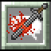
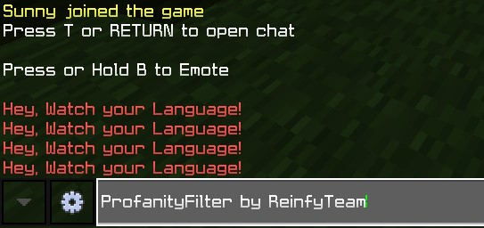
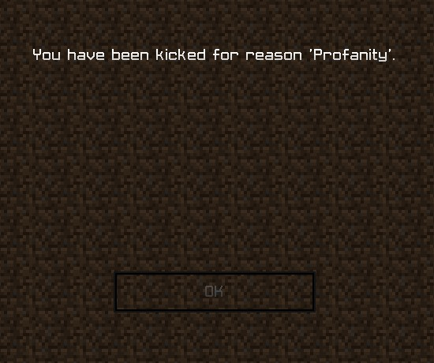
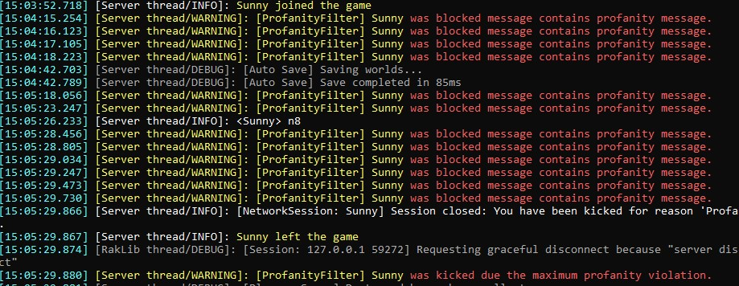
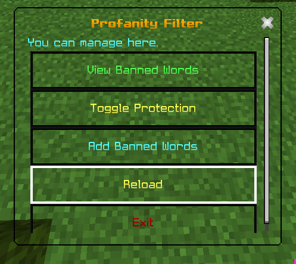
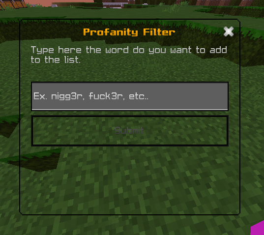
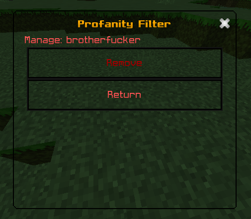
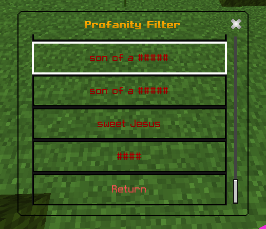

  <b>Configurable profanity filtering for PocketMine-MP.</b>  
  <b>ProfanityFilter</b> detects configured words in chat, can block or mask messages, and can apply configurable moderation actions.  
  Administrators can manage custom words and filter settings in-game or through the plugin data files.   
      
   
  <b>
  <a href="https://github.com/ReinfyTeam/ProfanityFilter/wiki">Wiki/Documentation</a> | <a href="https://poggit.pmmp.io/p/ProfanityFilter">Poggit</a> | <a href="https://github.com/ReinfyTeam/ProfanityFilter/">Github Repository</a> | <a href="https://github.com/ReinfyTeam/ProfanityFilter/issues">Create an issue.</a> | <a href="https://github.com/ReinfyTeam/ProfanityFilter/discussions">Discussions</a> | <a href="https://github.com/ReinfyTeam/ProfanityFilter/pulls">Create a pull request.</a>
  </b>

# Features
- Commando-based `/pf` command suite with pmforms GUI (view/add/remove/toggle/reload) for in-game management.
- Choose between the bundled profanity list (`profanity: provided`) or your own custom list in `plugin_data/ProfanityFilter/profanity.yml` (`banned-words` section); the provided list is refreshed and kept immutable on startup.
- Two filter modes: `block` (cancel the message) or `hide` (mask with a replacement character) with customizable warning text.
- Punishment pipeline with violation counter supporting kick, timed ban (`ban-duration`), or custom commands (console or player) after `max-violations`.
- Configurable permissions (`command-permission`, `bypass-permission`), update checker toggle, and language system (English & Vietnamese, or add your own).

# Commands
- `/pf help` - show available subcommands.
- `/pf ui` - open the management UI (in-game only).
- `/pf list` - list banned words (custom list).
- `/pf add <word>` - add a word to the custom list.
- `/pf remove <word>` - remove a word.
- `/pf toggle` - enable/disable filtering until reload.
- `/pf reload` - reload plugin and profanity configs.

Default command permission: `profanityfilter.command` (configurable). Bypass chat filtering with `profanityfilter.bypass`.

# Configuration highlights
- `profanity`: `custom` to use `banned-words.yml`, or `provided` to use the bundled list.
- `type`: `block` to cancel profane messages, `hide` to mask them with `replacementCharacter`.
- `replacementCharacter`: single character used when hiding profanities.
- `max-violations`, `punishment-type` (`kick`|`ban`|`command`), `ban-duration`, `execute-as-player`, `command`: tune the punishment pipeline.
- `lang`: `eng`, `vie`, or `custom` (create `languages/custom.yml`).
- `check-updates`: enable/disable remote update checks.

## Installation

- Download a stable artifact from the [GitHub Releases](https://github.com/ReinfyTeam/ProfanityFilter/releases) page or [Poggit](https://poggit.pmmp.io/p/ProfanityFilter).
- Place `ProfanityFilter.phar` in the server's `plugins/` directory.
- Start the server once, then configure `plugin_data/ProfanityFilter/config.yml`.
- Manage custom words in `plugin_data/ProfanityFilter/profanity.yml` under the `banned-words` section, or use the in-game `/pf` commands.

# Changelog
See the [GitHub Releases](https://github.com/ReinfyTeam/ProfanityFilter/releases) page for the current stable version and `changelogs/v0.2.x.md` for the release notes.

## Report an issue or bug
You found a bug or a plugin issue?
- Contact support in the [Discord Server](https://discord.gg/v2rNeHaptd)
- Create an [Issue](https://github.com/ReinfyTeam/ProfanityFilter/issues)
- Write your bug & the issue you are having with all informations including the crash or errors so I can track the issue.
- Submit the issue and be patient for a response for a solution to your problem :D

## Compatibility note

This plugin targets the PocketMine-MP API declared in `plugin.yml`. If you use a fork, report its name, version and the complete error output so compatibility can be investigated accurately.

# Screenshots

# Contributors and Collaborators
| Name                                        | Contributors                                                                                     |
|---------------------------------------------|--------------------------------------------------------------------------------------------------|
| [NhanAZ](https://github.com/NhanAZ)         | Maintained this Plugin and helped me alot of things like syntax, languages and code improvement. |
| [KanadeDev](https://github.com/KanadeDev)   | Helped me alot of language files, and fixed alot of couple things in first release.              |
| [Reinfy](https://github.com/Reinfy)         | He implemented some things and fixing and adjusting features, suggesting some improvements.      |
| [kotyaralih](https://github.com/kotyaralih) | Made more translation to the language files.                                                     |
